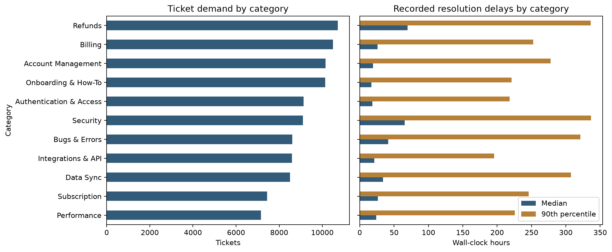

# IT Support Analytics & Ticket Resolution Prediction

## Project Overview

An end-to-end support analytics project using Python, PostgreSQL, scikit-learn,
SHAP, and Streamlit. The dashboard summarizes historical ticket demand and
resolution times. A separate classifier estimates whether a new ticket will
resolve in under 24 hours.

## Business Problem

Support leads need to know where tickets accumulate and which issues often take
longer to resolve. An opening-time estimate can help prioritize monitoring,
while the dashboard provides context about workload and observed delays.

## Objectives

- Quantify ticket volume, delay, and outcome coverage across support segments.
- Compare opening-time classifiers against a majority-class baseline.
- Explain model scores and make the analytics and prediction workflows available
  in Streamlit.

## Dataset

The local CSV contains **100,000 synthetic support tickets** and **38 columns**.
Its schema and a preview record match the public `humans_only` configuration of
Talgat Kozahmetov's
[Support Tickets with an AI-Automation Counterfactual](https://huggingface.co/datasets/s2pidape/support-ticket-dataset),
published under CC BY 4.0. The exact local export history remains unverified.
The [dataset selection report](reports/dataset_selection.md) documents the checks
and limitations. Raw data, processed data, and fitted models are Git-ignored.

## Methodology

```text
CSV -> audit and cleaning -> typed Parquet -> exploratory analysis
                                           -> PostgreSQL -> historical dashboard
                                           -> features and labels -> temporal splits
                                               -> model comparison -> evaluation and SHAP
                                               -> prediction and model insights dashboard
```

## Data Cleaning

The pipeline trims whitespace, preserves missing values, validates types and
ticket IDs, removes exact duplicates when present, and flags timestamp and
duration inconsistencies. The cleaned export excludes names, emails, and free
text. The full run retained **100,000 rows** and produced **37 columns**.
See the [cleaning notebook](notebooks/02_data_cleaning.ipynb).

## Exploratory Data Analysis

Refunds had the highest volume (**10,723 tickets**) and the highest category
median wall-clock delay (**69.62 hours**). Ticket intake rose from **24,924** in
2022 to **41,341** in 2024. December 2024 had **72.3%** recorded-outcome coverage,
which affects comparisons with earlier cohorts.
See the [EDA notebook](notebooks/03_eda.ipynb).



## Feature Engineering

Category, product, channel, and creation date and time supply seven opening-time
features. The timestamp yields hour, weekday, month, and a weekend indicator.
Eligible outcomes use recorded wall-clock hours. Under 24 hours is fast, and
24 hours or longer is slow. Outcome fields and ticket identifiers stay outside
the model inputs.

## Machine Learning

The [ML notebook](notebooks/04_machine_learning.ipynb) trains logistic regression,
a decision tree, and a random forest alongside a majority-class baseline. Each
pipeline fits categorical encoding, imputation, and scaling on training data.
Validation and test tickets come from later periods. The split excludes earlier
tickets whose outcomes were unavailable at the next boundary.

## Model Evaluation

The random forest led validation ROC-AUC (0.677 versus 0.675 for the decision
tree). The selected pipeline was refit on 70,634 training and validation
tickets with known outcomes at the test boundary. Results on **16,569 held-out
tickets** follow. Precision, recall, and F1 use fast resolution as the positive class.

| Model | Accuracy | Precision | Recall | F1 | ROC-AUC |
|---|---:|---:|---:|---:|---:|
| Majority baseline | 0.528 | 0.000 | 0.000 | 0.000 | 0.500 |
| Random forest | 0.632 | 0.600 | 0.661 | 0.629 | 0.682 |

[Held-out confusion matrix](reports/figures/test_confusion_matrix.png)

## Explainable AI

SHAP explains the slow-resolution score by adding signed feature effects to
a model baseline. The global ranking averages absolute effects across 256
held-out tickets. Weekday and category had the largest average effects.
[Global feature importance](reports/figures/shap_feature_importance.png) and
[individual SHAP explanation](reports/figures/shap_slow_resolution_example.png)
show both views.

## PostgreSQL

The [schema](sql/schema.sql) stores one row per ticket, keyed by ticket ID.
The loader uses a transaction and updates existing IDs when rerun. The
[six SQL queries](sql/queries.sql) cover category demand, priority delays,
team workload, monthly trends, slow-resolution share, and recurring issues.
Delay summaries use recorded durations. Class rates use eligible labels.

## Streamlit Dashboard

| Page | What you can do |
|---|---|
| Overview | Review volume, average resolution time, fast and slow rates, and trends. |
| Ticket Analytics | Filter by category, priority, assigned team, channel, and creation date. |
| Resolution Prediction | Enter a new ticket and see its predicted class, probability, and SHAP factors. |
| Model Insights | Compare validation scores, held-out metrics, and explanation charts. |

The analytics pages use PostgreSQL. The model pages read local artifacts.

## Project Architecture

```text
app/          Streamlit dashboard and model pages
data/         Ignored raw and processed data directories
models/       Ignored fitted classifier and dashboard metrics
notebooks/    Exploration, cleaning, EDA, training, evaluation, and SHAP
reports/      Dataset notes and figures
sql/          PostgreSQL schema and analytical queries
src/          Audit, preprocessing, feature, training, loading, and explanation code
tests/        Data pipeline and Streamlit tests
```

## Installation

The project was verified with Windows PowerShell, Python 3.14, and PostgreSQL 18.
Run commands from the repository root.

```powershell
python -m venv .venv
.\.venv\Scripts\python.exe -m pip install -r requirements.txt
.\.venv\Scripts\python.exe -m pip check
.\.venv\Scripts\python.exe smoke_test.py
```

For the notebooks, select the `.venv` Python kernel in VS Code or JupyterLab.

## Usage

1. Place the input CSV at `../tickets.csv` relative to the repository root.
   Use the 100,000-ticket input described in Dataset to reproduce the reported figures.
2. Audit the file and generate the processed dataset.

   ```powershell
   .\.venv\Scripts\python.exe src\dataset_audit.py
   .\.venv\Scripts\python.exe src\preprocessing.py
   ```

3. Run [03_eda.ipynb](notebooks/03_eda.ipynb) to regenerate the EDA figures.
   Run [04_machine_learning.ipynb](notebooks/04_machine_learning.ipynb)
   through **Export dashboard metrics** to generate the model and evaluation artifacts.
4. With a local PostgreSQL server running, create the database once, load
   the data, and optionally run the SQL analysis. Substitute your authorized role
   or server settings where needed. The commands prompt for the password.

   ```powershell
   $postgresBin = 'C:\Program Files\PostgreSQL\18\bin'
   $env:PGHOST = 'localhost'
   $env:PGPORT = '5432'
   $env:PGUSER = 'postgres'
   & "$postgresBin\createdb.exe" --password it_support_analytics
   .\.venv\Scripts\python.exe -m src.load_postgres --prompt-password
   & "$postgresBin\psql.exe" --password -X -v ON_ERROR_STOP=1 -d it_support_analytics -f sql/queries.sql
   ```

5. Launch Streamlit and open its **Local URL**. On the analytics pages, enter
   the PostgreSQL password and click **Connect**. Reconnect after updating
   the database to refresh the session's data.

   ```powershell
   .\.venv\Scripts\python.exe -m streamlit run app\app.py
   ```

6. Run the tests. Checks that require model artifacts report a skip if those
   artifacts have yet to be generated.

   ```powershell
   .\.venv\Scripts\python.exe -m pytest -q
   ```

## Results

The random forest improved held-out accuracy by **10.4 percentage points**
over the majority baseline. It correctly flagged **5,311 of 8,751** slow
tickets and predicted fast for **3,440** slow tickets. The latter matters
if a support team uses the score to decide which cases to monitor.

## Limitations

- Model scores describe simulated tickets and have yet to be validated on a live support desk.
- Delay statistics use observed outcomes. Missing outcomes limit comparisons,
  especially for the latest creation cohorts.
- Feature importance describes model behavior. Correlated inputs can share
  SHAP contributions.
- The 24-hour cutoff is a project definition. The source also has per-ticket SLA targets.

## Future Improvements

- Validate on recent operational data and monitor performance by time and support segment.
- Compare decision thresholds using the relative costs of missing a slow case
  and escalating a fast one.
- Evaluate whether opening-time descriptions add signal after reviewing text
  quality and handling personal information.

## Technologies

Python, Pandas, NumPy, Matplotlib, Seaborn, scikit-learn, SHAP, PostgreSQL,
Psycopg, Streamlit, Altair, Jupyter, and pytest.

For repository publishing commands and dashboard captures, see the
[GitHub publishing checklist](reports/github_checklist.md).
